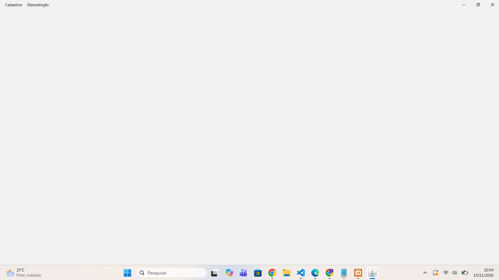
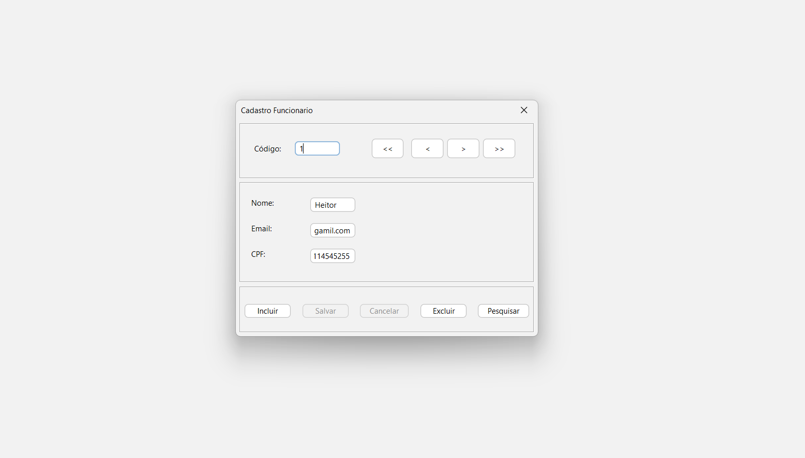
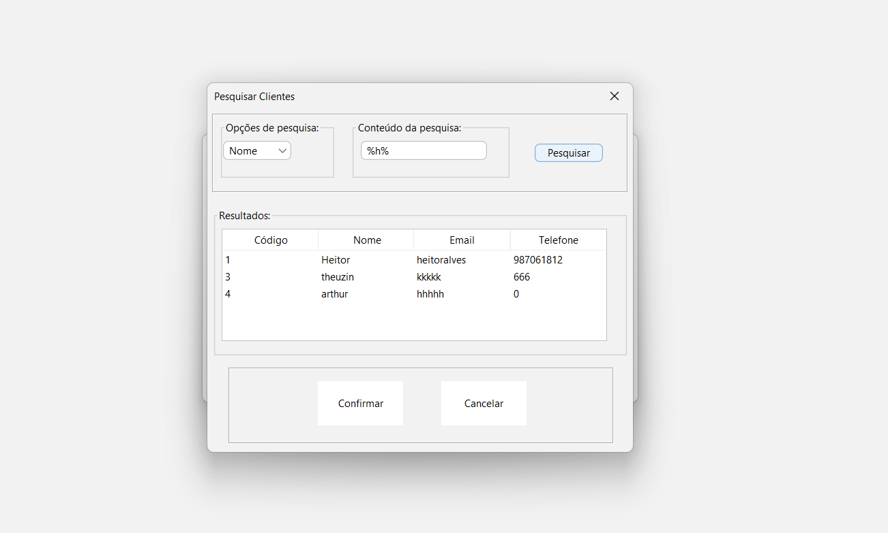

# 👕 TogCompany - Sistema de Loja de Roupas

Sistema desktop para gestão de uma loja de roupas, desenvolvido em **Java** com interface **Swing** e banco de dados **MySQL**.

## 📸 Telas

### Tela principal


### Cadastro de produto


### Pesquisa de clientes


## ⚙️ Funcionalidades

- Cadastro, edição, exclusão e navegação de **Clientes**
- Cadastro de **Funcionários**
- Cadastro de **Fornecedores**
- Cadastro de **Produtos** vinculados a **Categorias**
- Pesquisa com filtros em todas as telas

## 🛠️ Tecnologias

- Java 20+
- Java Swing com [FlatLaf](https://www.formdev.com/flatlaf/) (visual moderno)
- MySQL
- Maven
- Arquitetura em camadas: **Modelo**, **Visão**, **Controle** e **DAO**

## 📁 Estrutura do projeto

```
projetofinal/Projetofina/src/main/java
├── Modelo     → classes de dados (Cliente, Produto...)
├── Visao      → telas do sistema
├── Controle   → ligação entre as telas e o banco
└── Dao        → acesso ao banco de dados
```

## ▶️ Como executar

**Pré-requisitos:** JDK 20 ou superior, MySQL e VS Code com a extensão *Extension Pack for Java*.

1. Clone o repositório:
   ```
   git clone https://github.com/heitoralves352-hub/projetofinal---loja-de-roupas.git
   ```
2. No MySQL, execute o script `banco/projeto_final.sql` para criar o banco e as tabelas.
3. Se o seu MySQL tiver usuário ou senha diferentes de `root` / sem senha, ajuste o arquivo `Dao/FabricaConexao.java`.
4. Abra o projeto no VS Code e execute o arquivo `Visao/Vprincipal.java`.

## 👤 Autor

Desenvolvido por **[Heitor Barros Alves]**.